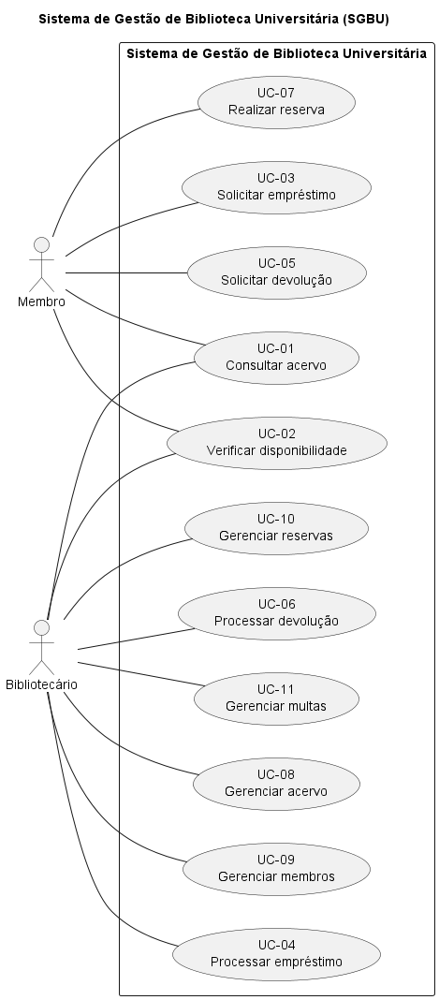

# TP1 - Sistema de Gestão de Biblioteca Universitária

**Disciplina**: Projeto de Bloco: Desenvolvimento Back-End

**Instituição**: Instituto Infnet

**Professor**: Orlando Fonseca

**Aluno**: Bruno César Pimentel Vieira

**E-mail**: brunoc.vieira@al.infnet.edu.br

**Linguagem escolhida**: C#

---

## 1. Introdução

Este documento apresenta o levantamento inicial dos requisitos do Sistema de Gestão de Biblioteca Universitária (SGBU), desenvolvido como parte do Projeto de Bloco da disciplina de Projeto de Bloco: Desenvolvimento Back-End.

O sistema tem como finalidade organizar o acervo bibliográfico e gerenciar as operações de empréstimo, devolução, reserva e cobrança de multas por atraso.

A documentação estabelece uma base para o desenvolvimento incremental da aplicação, permitindo que os requisitos e as regras de negócio sejam consultados e revisados durante as etapas subsequentes do projeto.

## 2. Objetivo do sistema

Desenvolver um sistema capas de gerenciar livros de uma biblioteca universitária, controlar o registro dos membros e garantir que as operações realizadas respeeitem as regras estabelecidadas pela instituição.

O sistema deverá contemplar:

- Gerenciamento do acervo;
- Cadastro e manutenção dos membros;
- Consulta aos livros e à disponibilidade dos exemplares;
- Registro e acompanhamento de empréstimo;
- Processamento de devoluções;
- Gerenciamento de reservas;
- Cálculo e controle de multas por atraso.

## 3. Idenfiicação das entidades

As entidades representam os principais elementos de informação utilizados pelo sistema.

| Entidade | Descrição | Atributos principais |
|---|---|---|
| Livro | Representa uma obra bibliográfica cadastrada no acervo. | Título, autor, ISBN |
| Exemplar | Representa uma unidade física de determinado livro. | Código de patrimônio, estado de conservação, livro relacionado |
| Membro | Representa um integrante da comunidade acadêmica. | Nome, matrícula, tipo |
| Empréstimo | Registra a retirada e a devolução de um exemplar. | Exemplar, membro, data de retirada, prazo, data de devolução |
| Reserva | Registra a solicitação de reserva de um livro. | Livro, membro, data da reserva |
| Multa | Representa a cobrança associada a um empréstimo atrasado. | Membro, empréstimo, valor, situação do pagamento |

### 3.1. Relacionamentos identificados

- Um livro pode possuir vários exemplares;
- Cada exemplar pertence a um livro;
- Um membro pode possuir vários empréstimos ao longo do tempo;
- Cada empréstimo relaciona um membro e um exemplar;
- Um membro pode realizar reservas;
- Cada reserva está vinculada a um livro, e não diretamente a um exemplar;
- Uma multa está vinculada ao membro responsável e ao empréstimo relacionado.

## 4. Identificação de atores
### 4.1. Ator A01 - Membro

Representa alunos, professores e funcionários da comunidade acadêmica que utilizam os serviços da biblioteca.

**Responsabilidades**:

- Consultar livros cadastrados;
- Verificar a disponibilizade de exemplares;
- Solicitar empréstimos;
- Solicitar devoluções;
- Realizar reservas de livros.

### 4.2. Ator A02 - Bibliotecário

Representa o responsável pela administração do acervo, dos membros e das operações da biblioteca.

**Responsabilidades**:

- Cadastrar, consultar, atualizar e remover registros;
- Gerenciar exemplares e suas condições;
- Processar empréstimos e/ou devoulções;
- Gerenciar reservas;
- Registrar e controlar multas.

## 5. Levantamento dos requisitos funcionais

| ID | Requisito funcional | Classificação |
|---|---|---|
| RF-001 | Permitir ao bibliotecário cadastrar, consultar, atualizar e remover livros do acervo. | Gestão do acervo |
| RF-002 | Permitir ao bibliotecário gerenciar exemplares físicos e registrar suas condições de conservação. | Gestão do acervo |
| RF-003 | Permitir ao bibliotecário cadastrar, consultar, atualizar e remover membros. | Gestão de membros |
| RF-004 | Permitir a consulta aos livros cadastrados no acervo. | Consulta |
| RF-005 | Informar a disponibilidade dos exemplares relacionados a cada livro. | Consulta |
| RF-006 | Permitir ao membro solicitar o empréstimo de um exemplar. | Empréstimo |
| RF-007 | Permitir ao bibliotecário processar empréstimos, validando as regras de negócio. | Empréstimo |
| RF-008 | Permitir ao membro solicitar a devolução de um exemplar. | Devolução |
| RF-009 | Permitir ao bibliotecário registrar a devolução e encerrar o empréstimo correspondente. | Devolução |
| RF-010 | Calcular multas em decorrência de atrasos na devolução. | Multa |
| RF-011 | Permitir ao bibliotecário registrar e controlar multas e suas situações de pagamento. | Multa |
| RF-012 | Permitir ao membro realizar reservas de livros conforme as regras de negócio. | Reserva |
| RF-013 | Permitir ao bibliotecário gerenciar as reservas realizadas. | Reserva |
| RF-014 | Restringir o gerenciamento administrativo aos bibliotecários/administradores. | Controle de acesso |
| RF-015 | Validar o cadastro dos membros antes de autorizar empréstimos e reservas. | Validação |

## 6. Levantamento dos requisitos não funcionais

Os requisitos não funcionais descrevem restrições técnicas e características de qualidade do sistema.

### 6.1. Restrições definidas no enunciado

| ID | Requisito não funcional | Categoria |
|---|---|---|
| RNF-001 | A implementação deverá utilizar C# com .NET 10 SDK, mantendo a linguagem escolhida durante todo o projeto. | Tecnologia |
| RNF-002 | O protótipo inicial do TP1 deverá funcionar como uma aplicação standalone. | Arquitetura |
| RNF-003 | O protótipo do TP1 deverá demonstrar tipos primitivos, operadores e controle de fluxo, sem implementar ainda o modelo de domínio orientado a objetos. | Implementação |
| RNF-004 | Nas etapas posteriores, o sistema deverá evoluir para um serviço web utilizando ASP.NET Core, persistência de dados, API e autenticação. | Evolução arquitetural |

### 6.2. Requisitosd de qualidade proposto

Os requisitos abaixo são propostas para orientar a implementação. Seus critérios de aceitação deverão ser validados nas próximas etapas.

| ID | Requisito não funcional | Categoria |
|---|---|---|
| RNF-005 | Apresentar mensagens compreensíveis quando uma operação for autorizada ou impedida. | Usabilidade |
| RNF-006 | Fornecer respostas consistentes para operações realizadas com os mesmos dados e condições. | Confiabilidade |
| RNF-007 | Definir e avaliar tempos de resposta aceitáveis para as operações de consulta e registro nas próximas etapas. | Desempenho |

Não foram estabelecidos valores quantitativos de desempenho no enunciado original

## 7. Regras de negócio

As regras de negócio foram extraídas da especificação prédefinida no enunciado do TP1.

| ID | Regra de negócio |
|---|---|
| RN-001 | O prazo padrão de empréstimo é de 14 dias corridos contados a partir da retirada. |
| RN-002 | A multa por atraso deve considerar os dias corridos posteriores ao prazo, até a devolução efetiva. |
| RN-003 | Cada membro pode possuir no máximo três empréstimos ativos simultaneamente. |
| RN-004 | Um exemplar somente pode ser emprestado se estiver disponível e em condições adequadas de uso. |
| RN-005 | Um exemplar não pode possuir mais de um empréstimo ativo simultaneamente. |
| RN-006 | Uma reserva somente pode ser realizada para um livro que possua exemplares atualmente emprestados. Não é permitida quando todos os exemplares estão disponíveis. |
| RN-007 | A reserva deve ser vinculada ao Livro, e não a um Exemplar específico. |
| RN-008 | A devolução deve encerrar o empréstimo ativo e registrar a data efetiva da devolução. |
| RN-009 | Quando houver atraso, o sistema deve calcular a multa proporcional aos dias corridos e vinculá-la ao membro responsável. |
| RN-010 | Exemplares danificados ou indisponíveis não podem ser emprestados até sua condição ser regularizada pelo bibliotecário. |
| RN-011 | Somente o Bibliotecário/Administrador pode manter registros, processar operações administrativas e gerenciar multas. |
| RN-012 | O membro deve possuir cadastro válido para realizar empréstimos e reservas. |

## 8. Especificações dos casos de uso

Foram selecionados três casos de uso principais:

- Processamento de empréstimo;
- Processamento de devolução;
- Realização de reserva.

### 8.1. UC-04 - Processar empréstimo

**Ator principal**: Bibliotecário

**Ator participante**: Membro

**Objetivo**: Registrar o emprestimo de um exemplar para um membro da biblioteca.

**Pré-condições**:
- O bibliotecário está autorizado a processar operações administrativas;
- O membro e o exemplar estão identificados no sistema.

**Fluxo principal**:

1. O membro solicita o empréstimo de um exemplar.
2. O bibliotecário identifica o membro e o exemplar solicitado.
3. O sistema verifica a validade do cadastro do membro.
4. O sistema consulta a quantidade de empréstimos ativos do membro.
5. O sistema verifica a disponibilidade e as condições de conservação do exemplar.
6. O sistema confirma que as condições para o empréstimo foram atendidas.
7. O sistema registra a data de retirada.
8. O sistema determina o prazo de devolução de 14 dias corridos.
9. O sistema registra o empréstimo como ativo.
10. O sistema confirma a realização da operação.

**Fluxos alternativos**:

**FA-01 - Limite de empréstimos atingido**

Se o membro já possuir três empréstimos ativos, o sistema impede a operação e informa o motivo.

**FA-02 - Exemplar indisponível**

Se o exemplar estiver emprestado ou indisponível, o sistema impede o empréstimo.

**FA-03 - Exemplar em condição inadequada**

Se o exemplar estiver danificado ou impróprio para uso, o sistema impede a operação.

**FA-04 - Cadastro inválido**

Se o cadastro do membro for inválido, o empréstimo não será autorizado.

**Pós-condições**:

- O empréstimo estará registrado como ativo;
- O prazo de devolução estará definido;
- O exemplar não poderá ser emprestado simultaneamente a outro membro.

**Requisitos relacionados**: RF-007, RF-015, RN-001, RN-003, RN-004, RN-005, RN-010 e RN-012.

### 8.2. UC-06 - Processar devolução

**Ator principal**: Bibliotecário

**Ator participante**: Membro

**Objetivo**: Registrar a devolução de um exemplar e encerrar o empréstimo correspondente.

**Pré-condições**:

- O empréstimo correspondente está registrado como ativo;
- O bibliotecário está autorizado a processar devoluções.

**Fluxo principal**:

1. O membro solicita a devolução do exemplar.
2. O bibliotecário identifica o exemplar e o empréstimo correspondente.
3. O sistema consulta o prazo de devolução estabelecido.
4. O bibliotecário registra a data efetiva da devolução.
5. O sistema compara a data registrada com o prazo de devolução.
6. Caso não exista atraso, o sistema não gera multa.
7. O sistema encerra o empréstimo ativo.
8. O sistema confirma a devolução.

**Fluxos alternativos**:

**FA-01 - Devolução em atraso**

Se a data efetiva ultrapassar o prazo, o sistema calcula os dias corridos de atraso e registra a multa vinculada ao membro e ao empréstimo.

O valor monetário diário deverá ser definido antes da implementação completa do cálculo.

**FA-02 - Empréstimo não encontrado**

Se não existir empréstimo ativo correspondente ao exemplar, o sistema impede o encerramento e informa a inconsistência.

**Pós-condições**:

- O empréstimo estará encerrado;
- A data efetiva da devolução estará registrada;
- Se houver atraso, a multa correspondente estará registrada;
- O exemplar deixará de estar associado ao empréstimo ativo, mas continuará sujeito às condições de conservação para um novo empréstimo.

**Requisitos relacionados**: RF-009, RF-010, RF-011, RN-002, RN-008, RN-009 e RN-010.

### 8.3. UC-07 — Realizar reserva

**Ator principal**: Membro

**Objetivo**: registrar a reserva de um livro que possua exemplares atualmente emprestados.

**Pré-condições**:

- O livro está cadastrado no acervo;
- O membro está identificado no sistema.

**Fluxo principal**:

1. O membro acessa a consulta ao acervo.
2. O membro seleciona um livro.
3. O sistema verifica a validade do cadastro do membro.
4. O sistema consulta a situação dos exemplares vinculados ao livro.
5. O sistema confirma que existe pelo menos um exemplar atualmente emprestado.
6. O membro solicita a reserva do livro.
7. O sistema registra a reserva, vinculando-a ao livro e ao membro.
8. O sistema registra a data da reserva.
9. O sistema confirma a operação.

**Fluxos alternativos**:

**FA-01 - Livro sem exemplares emprestados**

Se não houver exemplares atualmente emprestados, o sistema impede a reserva.

**FA-02 - Cadastro inválido**

Se o membro não possuir cadastro válido, o sistema impede a operação.

**Pós-condições**:

- A reserva estará registrada;
- A reserva estará associada ao livro, sem apontar um exemplar específico.

**Requisitos relacionados**: RF-005, RF-012, RF-015, RN-006, RN-007 e RN-012.

## 9. Rastreabilidade dos casos de uso

A tabela relaciona os casos de uso às funcionalidades correspondentes.

| Caso de uso | Requisitos funcionais | Regras principais |
|---|---|---|
| UC-04 — Processar empréstimo | RF-007, RF-015 | RN-001, RN-003, RN-004, RN-005, RN-010, RN-012 |
| UC-06 — Processar devolução | RF-009, RF-010, RF-011 | RN-002, RN-008, RN-009, RN-010 |
| UC-07 — Realizar reserva | RF-005, RF-012, RF-015 | RN-006, RN-007, RN-012 |

## 10. Justificativa do escopo

### 10.1. Escopo incluído no TP1

A primeira entrega tem como objetivo estabelecer uma base técnica para o desenvolvimento do sistema.

Nesta etapa serão realizados:

- Levantamento e classificação dos requisitos;
- Identificação das entidades e dos atores;
- Documentação das regras de negócio;
- Especificação textual dos casso de uso;
- Elaboração do diagrama UML de casos de uso;
- Configuração do ambiente C#;
- Desenvolvimento de um programa standalone inicial, utilizando fundamentos de programação.

O programa inicial terá escopo limitado, representando uma pequena regra de negócio do domínio da biblioteca.

### 10.2. Funcionalidades previstas para as próximas etapas

As seguintes implementações serão desenvolvidas posteriormente:

- Classes orientadas a objetos para representar entidades;
- Aplicação completa das regras de negócio;
- Persistência de dados;
- Integração com banco de dados;
- Desenvolvimento da API utilizando ASP.NET Core;
- Autenticação e mecanismos de controle de acesso;
- Publicação do serviço web.

### 10.3. Justificativa técnica

A divisão do projeto permite compreender as regras do domínio antes de implementar estruturas mais complexas.

A documentação inicial contribui para reduzir ambiguidades e orientas as decisões técnicas nas fases seguintes.

O programa standalone será utilizado como exercício inicial de programalçao sem antecipar a implementação completa da arquitetura prevista para o projeto.

## 11. Suposições e pontos pendentes de validação

| ID | Questão identificada | Encaminhamento |
|---|---|---|
| SUP-001 | O valor monetário da multa por dia não foi informado. | Definir com o professor antes da implementação do cálculo. |
| SUP-002 | Não foram definidos todos os estados possíveis de conservação dos exemplares. | Definir uma classificação adequada antes da implementação. |
| SUP-003 | A ordem de atendimento das reservas não foi especificada. | Solicitar definição para a etapa de gerenciamento das reservas. |
| SUP-004 | Não foram estabelecidas regras de cancelamento ou expiração de reservas. | Manter como ponto pendente. |
| SUP-005 | A renovação de empréstimos não foi prevista no escopo oficial. | Não implementar sem uma definição adicional. |
| SUP-006 | Não foi informado se multas não pagas impedem novos empréstimos. | Não presumir essa restrição. |
| SUP-007 | Não foi definido o tratamento para um livro sem exemplares físicos cadastrados. | Solicitar esclarecimento para os fluxos de disponibilidade e reserva. |

Esses registros representam lacunas identificadas na especificação. Não devem ser interpretados como alterações nas regras estabelecidas pelo professor.

## 12. Conclusão

O levantamento realizado permitiu organizar as princiapis funcionalidades e restrições do SGBU.

A identificiação das e dos atores, juntamente com a documentação dos requisitos e casos de uso, fornece uma referência para o desenvolvimento das próximas etapas.

O projeto será conduzido de maneira incremental, preservando a rastreabilidade entre os requisitos levantados, a modelagem e a implementação.

Esta documentação será revisada conforme as decisões pendentes forem esclarecidas e as funcionalidades forem desenvolvidas.

## 13. Diagrama UML de Casos de Uso

O diagrama apresenta os atores e suas interações
com as principais funcionalidades do sistema.

